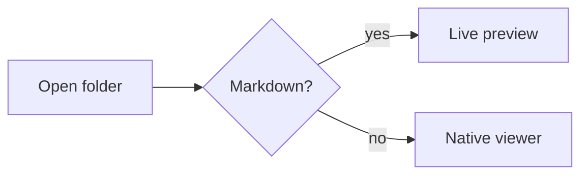

# MarkdownBrowser Samples

A fixture for checking rendering against GitHub. Open this folder in the app.

> [!NOTE]
> Click rendered blocks to edit their source in place. Cmd+click links to follow them; Cmd+U reveals all Markdown source.

## Text formatting

Some **bold**, *italic*, ~~strikethrough~~, `inline code`, and a [link to another page](docs/guide.md#installation).
Bare URLs autolink: https://github.com. Escaped \*asterisks\* stay literal.
Shortcodes become emoji :tada: :+1:, and footnotes are numbered[^first] in order of use[^second].

Inline math $e^{i\pi} + 1 = 0$ and a block:

$$
\int_0^\infty e^{-x^2}\,dx = \frac{\sqrt{\pi}}{2}
$$

## Lists

- [x] Render GitHub-flavored Markdown
- [x] Edit without reformatting
  - Nested bullet
    - Deeper bullet
1. First
2. Second

## Table

| Feature | Status | Notes |
|:--------|:------:|------:|
| Tables  | ✅     | aligned |
| Mermaid | ✅     | below |

## Code

See the [code language showcase](code-languages.md) for examples across many languages.

```swift
struct Greeting {
    let name: String
    func render() -> String { "Hello, \(name)!" }
}
```

## Diagram



## Image


## HTML

<details>
<summary>Click to expand</summary>

Hidden content with **Markdown** inside.

</details>

> [!WARNING]
> Changes are saved when the window loses focus (configurable in Settings).

---

See also the [reference link][guide].

[guide]: docs/guide.md

[^second]: Cmd+click a footnote number to jump here.
[^first]: Definitions can be in any order.
