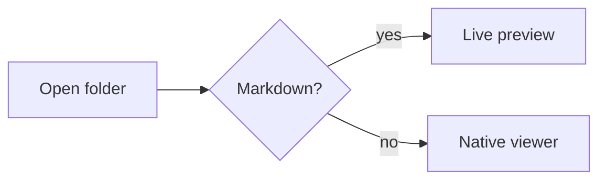

# MarkdownBrowser Samples

A fixture for checking rendering against GitHub. Open this folder in the app.

> [!NOTE]
> Cmd+click a link to follow it. Click anywhere to edit; the Markdown source appears where the caret is.

## Text formatting

Some **bold**, *italic*, ~~strikethrough~~, `inline code`, and a [link to another page](docs/guide.md#installation).
Bare URLs autolink: https://github.com. Escaped \*asterisks\* stay literal.

Inline math $e^{i\pi} + 1 = 0$ and a block:

$$
\int_0^\infty e^{-x^2}\,dx = \frac{\sqrt{\pi}}{2}
$$

## Lists

- [x] Render GitHub-flavored Markdown
- [ ] Edit without reformatting
  - Nested bullet
    - Deeper bullet
1. First
2. Second

## Table

| Feature | Status | Notes |
|:--------|:------:|------:|
| Tables  | ✅     | aligned |
| Mermaid | ✅     | below |

## Code

```swift
struct Greeting {
    let name: String
    func render() -> String { "Hello, \(name)!" }
}
```

## Diagram



## Image


## HTML

<details>
<summary>Click to expand</summary>

Hidden content.

</details>

> [!WARNING]
> Changes are saved when the window loses focus (configurable in Settings).

---

See also the [reference link][guide].

[guide]: docs/guide.md
