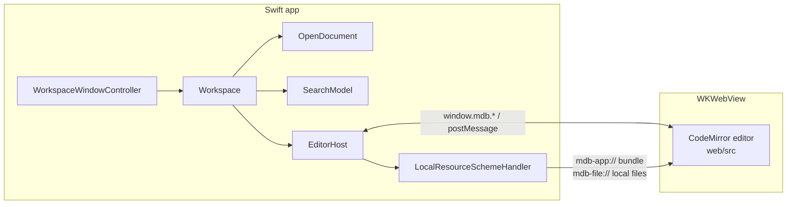

# Contributing

Thanks for helping out. This guide covers setting up the project, how it fits together, and what to check before submitting a change. By contributing, you agree that your contributions are licensed under the project's [MIT License](../LICENSE).

## Setup

```sh
brew install xcodegen node
xcodegen generate          # re-run whenever you add, remove or rename files
open MarkdownBrowser.xcodeproj
```

The Xcode project is generated from `project.yml` and is not checked in; edit `project.yml`, never the `.xcodeproj`.

To work on the editor alone:

```sh
cd web
npm ci
npm run dev                # Vite dev server; the bridge logs to the console instead of Swift
```

## How it fits together



- **Windows** are AppKit `NSWindowController`s hosting SwiftUI (`WindowManager`, `WorkspaceWindowController`). This gives us native tabs, close prompts and focus events. The SwiftUI `App` only declares the Settings scene and menu commands.
- **`Workspace`** is one window's session: root folder or file, the file tree, navigation history, the open document, find state and security-scoped access.
- **The sidebar** is an `NSOutlineView` (`FileOutlineView`) over a `FileTree` shared by every tab on the same folder. Folders are listed only when expanded, and rows are created only when visible, so folders with tens of thousands of files stay fast; keep it that way (no SwiftUI `List` over the whole tree). `Workspace.rootURL` and `tree` change when a folder is double-clicked or the user goes up (`setRoot`, `goUp`): the old tree is released, the new one acquired, the search root follows, and the outline is rebuilt (`.id` on the root URL). Going above the folders the sandbox has granted goes through `requestAccessTo`, like opening a file outside them.
- **The sidebar filter** (`SidebarFilterModel`, `FileFilter`, `FuzzyMatcher`, `FilterBar`, `FilterResultsView`) replaces the tree with a flat `NSTableView` of matches while the field is non-empty; clearing it brings back the untouched outline and its expansion state. `FuzzyMatcher` is a pure scorer (subsequence, case-insensitive, bonuses for consecutive characters and word starts). `FileFilter` runs off the main actor as a cancellable `AsyncStream` of growing snapshots, skipping hidden files and `FileKind.ignoredNames`, and keeps only the best `maxResults`. A non-recursive search lists just the folders the tree has expanded (`Workspace.visibleDirectories()`), never the whole tree. The model debounces and cancels on every keystroke.
- **`OpenDocument`** owns a file's encoding, line separator, on-disk hash and saving. The live text lives in the editor; Swift asks for a snapshot when saving. The editor also sends unsaved text about a second after typing stops, so `EditorHost` can restore it if the web process crashes.
- **`EditorHost`** wraps the `WKWebView` and the JS bridge. Swift calls `window.mdb.*` through `callAsyncJavaScript` with arguments, never by building script strings. JS posts typed messages (`ready`, `dirty`, `text`, `openLink`, `findStatus`, `error`) back.
- **`LocalResourceSchemeHandler`** serves the bundled editor (`mdb-app://bundle/`) and workspace files (`mdb-file://local/<path>`). Every local request is checked against the workspace's granted folders.
- **The editor** (`web/src`) is CodeMirror 6 with a live-preview layer:
  - `livePreview/inline.ts` hides Markdown syntax and styles text.
  - `livePreview/blocks.ts` replaces tables, HTML, math and Mermaid blocks with rendered widgets when the cursor isn't inside them.
  - `render/` holds the GitHub-compatible HTML pipeline, Mermaid and KaTeX.
  - `search/engine.ts` is the find bar's find-and-replace logic. Find in Files uses `SearchEngine`, which runs a Rust port of it (`native/mdb-core/src/search.rs`, JavaScript regex through `regress`); both are checked against `goldens/search.json` so they match the same way.
- **The native core** (`native/`) is a Rust workspace exposed to Swift through UniFFI. `native/build.sh`, a pre-build phase of the `MdbCore` target, builds it for the active architectures into the products folder and generates the Swift bindings into `native/generated/` (not committed). `MdbCore` compiles those bindings without main-actor isolation; the app links `libmdb_core.a`.

## Rules worth knowing

**Never re-serialize Markdown.** The document is always the raw source. Rendering is done with decorations, and every edit is a plain text change, so saving writes back the original bytes plus the user's edits. Don't introduce anything that parses Markdown into a model and prints it back.

**Preserve the file's bytes.** `TextCodec` keeps the encoding and BOM. The editor is created with the file's line separator (`EditorState.lineSeparator`). Always get text with `state.sliceDoc()` (which uses that separator), not `doc.toString()`. When positions must match document offsets, use `doc.toString()`.

**Treat document content as untrusted.**
- HTML goes through `rehype-sanitize` with GitHub's schema.
- The page has a strict CSP (`web/index.html`).
- Mermaid runs with `securityLevel: "strict"`.
- Web navigation is blocked (`EditorHost` navigation delegate).
- Only `http`, `https` and `mailto` links leave the app.
- Paths are checked with `PathPolicy`, which resolves `..` and symlinks.

**Swift concurrency.** The app target uses Swift 6 with `MainActor` as the default isolation. Pure value types and helpers that run off the main thread must be marked `nonisolated` (see `TextCodec`, `FileKind`, `PathPolicy`, `FolderSearch`).

**Comments** explain what the code can't say on its own, in one short line. Don't restate the code.

**Dependencies**: prefer what's already there. New npm packages end up in the app bundle, so justify their size.

## Common changes

- **New setting**: add a key and default in `Settings/AppSettings.swift`, a control in `Settings/SettingsView.swift` (`@AppStorage`), and read it where needed.
- **New bridge call**:
  1. Add the JS function to the object returned by `createEditor` in `web/src/editor.ts`.
  2. Add a Swift wrapper in `EditorHost`.
  3. For a JS → Swift message, add it to `OutMessage` in `web/src/bridge.ts` and handle it in `EditorHost.receive`.
- **New rendered Markdown construct**:
  - Inline constructs belong in `livePreview/inline.ts`.
  - Multi-line blocks belong in `livePreview/blocks.ts` (block widgets must come from a `StateField`).
  - Keep the source revealed when the selection touches it.
- **New file type**: classify it in `Workspace/FileKind.swift`, then pick a viewer in `Views/DocumentArea.swift`.
- **App icon**: edit and run `swift scripts/make-icon.swift`, which redraws every size in `Assets.xcassets/AppIcon.appiconset`; commit the PNGs.

## Testing

Run everything before submitting. While the repository is private, CI runs the Swift tests only on demand (**Actions › app › Run workflow**), so the local run is the check that counts:

In VS Code, run **Build and Run MarkdownBrowser** from the Agents Run button or
**Tasks: Run Task**. It installs the web dependencies, type-checks, tests and builds
the editor, generates the Xcode project, compiles and runs the Swift tests, and
launches the app only if every step succeeds.

```sh
# Swift unit tests (Swift Testing)
xcodebuild -project MarkdownBrowser.xcodeproj -scheme MarkdownBrowser -derivedDataPath build test

# Editor: type check and unit tests (Vitest + jsdom)
cd web && npx tsc --noEmit && npx vitest run

# Native core: unit tests and the goldens replay (release mode keeps the replay fast)
cd native && cargo test --release && cargo clippy --all-targets --features mdb-core/bindgen
```

What the suites cover:

- **Swift**:
  - encoding and line-ending round trips
  - path containment
  - file classification
  - scheme URLs and byte ranges
  - search and replace
  - saving, conflict detection and autosave
- **Native core** (`native/mdb-core`): find and replace, including a replay of `goldens/search.json`.
- **Editor**:
  - byte-exact round trips
  - live-preview rendering
  - footnotes, emoji shortcodes and HTML blocks split by blank lines
  - task toggles
  - anchors
  - HTML sanitizing
  - find and replace, including parity between the find bar and the Find in Files engine
  - search goldens: `test/searchGoldens.test.ts` records the engine's results over a fixed corpus in `goldens/search.json`, the reference for the native engine (see `docs/native-migration-plan.md`). If a dependency update changes them, review the diff and run `npm run goldens` to accept it.

Some things can only be checked by hand. Open `Samples/` in the app and confirm:

1. The README renders like it does on GitHub, in light and dark mode, including the table, alerts, math, image and Mermaid diagram.
2. Clicking text reveals its Markdown; clicking away renders it again.
3. Editing and saving changes only what you typed (`git diff` or `cmp` against a copy).
4. ⌘-clicking `docs/guide.md#installation` opens the guide at that heading, and ⌘[ goes back.
5. Editing a file in another app reloads it, or shows the conflict banner if you have unsaved changes.
6. With unsaved edits, `pkill -f com.apple.WebKit.WebContent` (closes web content in other apps too) restores the editor with the edits still unsaved.
7. Find bar and Find in Files work in each scope, with wrap on and off.
8. `cli/mdb` opens the current directory and given paths.

When you fix a bug, add a test that fails without the fix.

## Releasing

Push a version tag; the `release` workflow tests, builds and attaches `MarkdownBrowser-<version>.zip` and its SHA-256 to a GitHub release (tags with a `-suffix` become pre-releases):

```sh
git tag v0.2.0 && git push origin v0.2.0
```

To build the same zip locally, run `scripts/build-release.sh 0.2.0` (output in `dist/`, `SKIP_TESTS=1` to skip the tests). Builds are signed ad hoc unless `DEVELOPER_ID_APPLICATION` is set; notarization also needs `NOTARY_PROFILE` (from `xcrun notarytool store-credentials`) or `NOTARY_KEY_PATH`, `NOTARY_KEY_ID` and `NOTARY_ISSUER`. The workflow doesn't set these yet.

## Submitting changes

- Keep changes focused; separate refactors from behavior changes.
- Describe what changed and how you tested it, including the manual checks above that apply.
- Update `README.md` when you change features, shortcuts, requirements or limitations.
